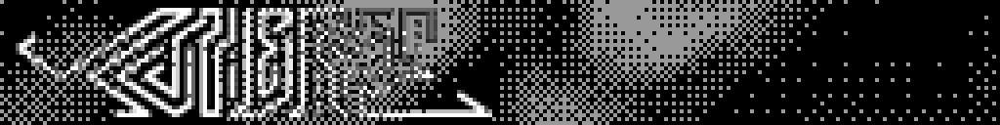

# Yuniverse's TENET Hub packages

Community packages for [TENET Hub](https://github.com/yuniverse-au/tenet-hub), the app for the Metakey TENET 70's screen.

## Add them to TENET Hub
In TENET Hub open **Packages → Community sources…**, paste `https://github.com/yuniverse-au/yuniverseTenetPackage` and click **Add**.

## Packages

### Yuniverse dither (`yuniverse-dither`)


The [yuniverse.au](https://yuniverse.au) homepage background: flowing noise through an 8×8 Bayer dither, with the Yuniverse logo blended over it. A seamless 7.5 s loop (60 frames at 8 fps).

- **Kind:** animation (a GIF for the image screen; it runs no code).
- **Needs:** REVIVER v16 or newer (v26 or newer for its own screen). 60 of the keyboard's ~180 frames on a 1 MB chip.
- **Use it:** on REVIVER v26 or newer, turn it on in the **Packages** tab: TENET Hub stores it on the keyboard as a screen of its own (place it in the **Screens** tab). On older firmware, open the **Image screen** tab, pick *Yuniverse dither* and click *Put it on the keyboard*. Either way it's stored on the keyboard, so it plays even with the PC off.
- **Reads or sends:** nothing.

The GIF is generated: [`source/yuniverse-dither/generate.py`](source/yuniverse-dither/generate.py) renders it from the logo (`python generate.py logo_256x32.png animation.gif`).

## Making changes
Raise the package's `version`, then rebuild the catalogue with TENET Hub's tool and commit `packages/`, `catalog/` and `index.json`:

```
python ../tenet-hub/tools/build_index.py --community --root . --name "Yuniverse"
```
